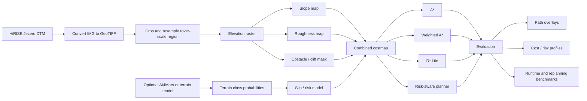
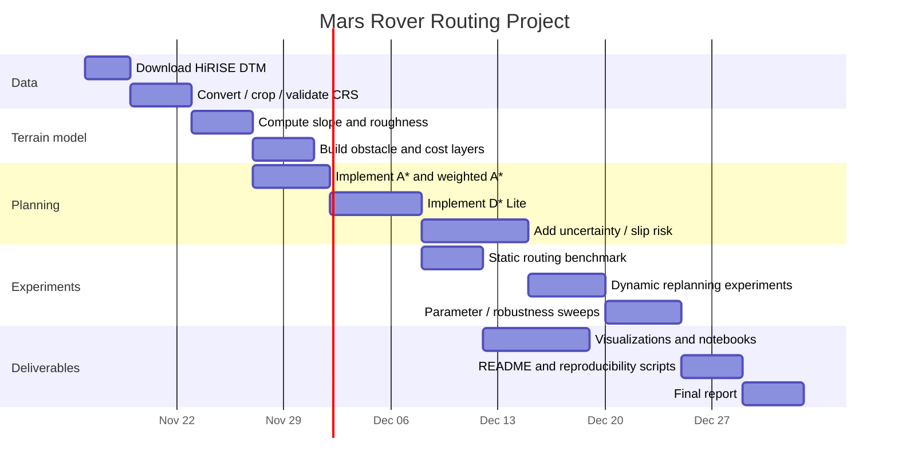

# Mars Rover Route-Planning Literature: Variables, Datasets, Algorithms, and a Reproducible CS Project

iturn457767image0

## Executive summary

Mars rover route planning is best understood as a **multi-layer optimization problem**, not simply “find the shortest path.” Operational systems combine orbital maps and rover-local perception to estimate traversability, then optimize some mixture of distance, time, terrain risk, slip, vehicle geometry, computational cost, and—more recently—scientific value and uncertainty. The progression in the literature is clear: early operational planners such as Field D* primarily solved geometric global-navigation failures; later work incorporated terrain type, slope, rock abundance, wheel slip, energy, and uncertainty; current work increasingly combines model-based safety with machine learning and active information gathering. citeturn990106search2turn927514search3turn336269search0turn282554search8

For a computer-science project, the most useful variables are **elevation, slope, roughness, rock/obstacle probability, terrain class, predicted slip, distance, turning cost, and uncertainty**. These variables recur because they can be converted into raster cost layers and combined with standard graph-search algorithms. Thermal inertia is useful as an indirect soil/mobility cue; illumination becomes important for solar-powered rovers; scientific value is useful for exploration rather than pure transit. Communication windows and localization uncertainty appear in the broader autonomous-mission-planning literature but are much less common in practical Mars traverse planners than geometric and terramechanical costs. citeturn666650search2turn282554search4turn666650search3turn927514search4

The strongest publicly reproducible starting point is a **HiRISE digital terrain model of Jezero Crater** combined with A*, D* Lite/Field-D*-style replanning and a terrain-cost model derived from slope and roughness. A specific public HiRISE Jezero DTM is available at **1 m/pixel and about 700 MB**, with accompanying orthorectified imagery; HiRISE DTM products are PDS raster `.IMG` files and can be converted to GeoTIFF with GDAL. HiRISE imagery is public domain. citeturn235153search1turn235153search0turn924918view3

For machine-learning extensions, **AI4Mars** provides rover imagery and semantic terrain labels, while Endo et al.'s 2023 ICRA work is unusually useful because the authors released **MIT-licensed code, pretrained models, notebooks, and experiment datasets** for risk-aware path planning based on probabilistic slip prediction. The ETH Zürich *Traversing Mars* project similarly provides an MIT-licensed ROS implementation for cooperative informative path planning. citeturn958305search2turn374437view0turn374437view1

My recommended reading order for a practical routing project is: **Toupet et al. 2025 ENav → Carsten et al. 2009 Field D* → Hedrick et al. 2020 terrain-aware replanning → Daftry et al. 2022 MLNav → Endo et al. 2023 risk-aware planning → Candela & Wettergreen 2022 science/risk planning**. Together they cover actual flight architecture, global replanning, map construction, learned search acceleration, uncertainty-aware slip risk, and science-aware planning. citeturn457767search5turn990106search2turn927514search3turn336269search0turn282554search8turn710817search0

## Core peer-reviewed route-planning literature

The following papers are the most directly relevant primary sources I found. I prioritized papers that either describe **Mars flight software**, operate on **real Mars terrain**, or introduce methods that map cleanly to a reproducible rover-routing implementation.

| Paper and link | Objective / optimization criteria | Variables and features | Sensors / source data | Algorithms / methods | Evaluation data | Public code/data status |
|---|---|---|---|---|---|---|
| **Carsten, J., Rankin, A., Ferguson, D., & Stentz, A. (2009). “Global planning on the Mars Exploration Rovers: Software integration and surface testing.” *Journal of Field Robotics*, 26(4), 337–357. [DOI](https://doi.org/10.1002/rob.20287).** citeturn990106search2 | Reach commanded waypoint safely while escaping extended obstacle configurations that defeated local GESTALT; efficiency constrained by MER flight hardware. | Local traversability, obstacle occupancy, goal distance, steering bias; terrain hazards derived from stereo. | MER Navcam/Hazcam-style stereo perception feeding GESTALT traversability maps. | **Field D\*** global planning integrated with GESTALT local arc selection. | MER Surface System Testbed and later Mars deployment. | Paper/PDF public through author/archival sources; I did **not verify an official release of the MER flight implementation**. citeturn990106search9turn927514search6 |
| **Fink et al. (2019). “Globally optimal rover traverse planning in 3D using Dijkstra’s algorithm for multi-objective deployment scenarios.” *Planetary and Space Science*, 179, 104707. [DOI](https://doi.org/10.1016/j.pss.2019.104707).** citeturn927514search1 | Produce globally/Pareto-optimal rover traverses balancing safety and mission objectives. | 3-D distance, elevation change, roughness/smoothness, deployment steps, terrain traversability; framework permits additional terrain-derived constraints. | Orbital and rover-derived 3-D terrain information; Curiosity/Gale terrain is the operational motivation. | Multi-objective **Dijkstra** / Pareto-front search (GRTOP). | Mars/Curiosity-motivated 3-D terrain scenarios. | No official reusable GRTOP repository was verified in the primary/publication records I found. citeturn424182search8 |
| **Hedrick, G., Ohi, N., & Gu, Y. (2020). “Terrain-Aware Path Planning and Map Update for Mars Sample Return Mission.” *IEEE Robotics and Automation Letters*, 5(4), 5181–5188. [DOI](https://doi.org/10.1109/LRA.2020.3005123).** citeturn927514search3 | Minimize **drive time per sol** while enabling replanning when actual mobility differs from orbital predictions. | Terrain class, **rock abundance, slope, expected velocity**, measured speed; later thesis work also connects slope/thermal data to slip. | Orbital Mars data including HiRISE-scale mapping; rover wheel-slip/speed feedback. | Cost-map construction; offline generation of alternate paths; online map update and route reselection. | Gusev/Columbia Hills Mars maps with simulated ground-truth perturbations. | Paper is public; no associated official source-code repository was verified. citeturn666650search8turn666650search2 |
| **Hedrick, G., & Gu, Y. (2021). “Terrain-aware traverse planning for a Mars sample return rover.” *Advanced Robotics*, 35, 1286–1301. [DOI](https://doi.org/10.1080/01691864.2021.1955000).** citeturn282554search3 | Predict mobility from orbit, select fastest traverse, update predictions from observed slip, and replan. | **Slope, rock abundance, terrain type, thermal information, slip, speed**, soil intrinsic parameters. | Orbital Mars imagery/topography plus in-situ wheel behavior and proposed shear-vane measurements. | Expected-velocity mapping + route search + forward propagation of updated terrain estimates. | Real Mars-derived terrain plus laboratory/field soil experiments. | Dissertation is openly accessible; no official planner repository was verified. citeturn666650search2 |
| **Sakayori, G., & Ishigami, G. (2021). “Energy-aware trajectory planning for planetary rovers.” *Advanced Robotics*, 35, 1302–1316. [DOI](https://doi.org/10.1080/01691864.2021.1959396).** citeturn282554search4 | Maximize **energy margin** rather than shortest distance. | Vehicle velocity, terrain inclination/slope, attack angle, wheel-soil interaction, power consumption, solar generation, rover orientation and Sun position. | Dynamic rover simulation and solar-array model rather than a specific Mars orbital dataset. | Neural-network power model + graph search + time-domain trajectory optimization. | Simulated slopes and rover dynamics. | No official public code/data release was verified from the publication source. citeturn282554search4 |
| **Daftry, S. et al. (2022). “MLNav: Learning to Safely Navigate on Martian Terrains.” *IEEE Robotics and Automation Letters*, 7(2), 5461–5468; also presented at ICRA 2022. [DOI](https://doi.org/10.1109/LRA.2022.3156654). [PDF](https://authors.library.caltech.edu/records/wmv09-93s03).** citeturn336269search0 | Reduce expensive model-based collision checks while **retaining hard safety guarantees**. | Terrain **heightmap**, candidate-path geometry, learned feasibility scores, collision-check outcomes. | Real terrain observed by Perseverance plus high-fidelity simulated terrains. | Search-based planner with **learned heuristic** that ranks paths before model-based safety checking. | Real Perseverance Mars terrain + challenging synthetic terrains. | Accepted manuscript public; author/public pages do not link a public MLNav codebase. The paper reports roughly a **10× reduction in collision checks** on real terrain relative to baseline ENav. citeturn666650search4turn666650search9 |
| **Candela, A., & Wettergreen, D. S. (2022). “An Approach to Science and Risk-Aware Planetary Rover Exploration.” *IEEE Robotics and Automation Letters*. [DOI](https://doi.org/10.1109/LRA.2022.3191949); presented at IROS 2022.** citeturn710817search0turn424182search4 | Increase **science return** subject to bounded mobility risk. | Mineralogical/science uncertainty, information gain, terrain geometry, semantic terrain class, predicted **wheel slip**, probabilistic risk. | Real Mars surface data for Jezero; thesis implementation uses CRISM-scale science data and local slope constraints. | Bayesian/statistical learning + information-theoretic science utility + risk-constrained graph/path planning. | Jezero Crater simulation with real Mars science/terrain data. | Paper/thesis public; no official code release was verified. citeturn710817search8turn666650search3 |
| **Endo, M., Taniai, T., Yonetani, R., & Ishigami, G. (2023). “Risk-aware Path Planning via Probabilistic Fusion of Traversability Prediction for Planetary Rovers on Heterogeneous Terrains.” *ICRA 2023*, 11852–11858. [DOI](https://doi.org/10.1109/ICRA48891.2023.10161466). [PDF](https://taniai.space/projects/safe-rover-navi/icra23-paper-copyright.pdf).** citeturn282554search8turn282554search7 | Avoid immobilization when learned traversability predictions are uncertain or wrong. | Terrain class probabilities, geometric features, **slip distributions**, prediction uncertainty, CVaR risk. | Appearance + geometry inputs; experiments use synthetic heterogeneous planetary terrain. | Terrain classifier + class-specific Gaussian-process slip models → mixture distribution → **CVaR risk cost** → path planning. | Released synthetic planning datasets, including different prediction-error conditions. | **Official MIT-licensed code, datasets, pretrained models and notebook are public:** [safe-rover-navi](https://github.com/omron-sinicx/safe-rover-navi). citeturn374437view0 |
| **Rockenbauer, F. M., Lim, J., Müller, M. G., Siegwart, R., & Schmid, L. (2025). “Traversing Mars: Cooperative Informative Path Planning to Efficiently Navigate Unknown Scenes.” *IEEE Robotics and Automation Letters*, 10(2), 1776–1783. [DOI](https://doi.org/10.1109/LRA.2024.3513036).** citeturn282554search1 | Use a scout robot to discover the rover's **minimum-cost path** through uncertain terrain while reducing wear/time/risk. | Terrain cost, map uncertainty, candidate optimal-path corridor, scout observations. | Simulated/reconstructed planetary environments with rover/scout sensing. | **Informative path planning**, rover/scout cooperation, optimality/infeasibility termination guarantees. | ROS-based simulated experiments; repository data can grow to multiple GB. | **Official MIT-licensed implementation:** [scouting-ipp](https://github.com/ethz-asl/scouting-ipp). citeturn374437view1 |
| **Toupet, O., Ono, M., Del Sesto, T., Maimone, M., & McHenry, M. (2025). “Enhanced Autonomous Navigation on the Perseverance Mars Rover.” *IEEE Transactions on Field Robotics*, 3, 83–124. [DOI](https://doi.org/10.1109/TFR.2025.3636366).** citeturn457767search5 | Flight-qualified high-speed autonomous navigation through dense hazards under severe onboard compute limits. | Terrain geometry, rover orientation, collision clearance, wheel volumes, slip margin, candidate path quality, computation cost. | Perseverance **Navcam stereo**, FPGA-accelerated stereo processing, onboard terrain maps and rover odometry. | Two-stage path selection + orientation-sensitive collision checking approximating rover kinematic settling; local/global planning architecture. | Extensive testbed simulation and real Perseverance driving on Mars. | Publication is public through IEEE/JPL references; I did **not verify a public release of ENav flight source code**. ENav is the best description of the current operational Mars route-selection architecture. citeturn990106search4turn990106search7 |

A useful distinction is that **orbital strategic routing** and **onboard tactical routing** solve different problems. Orbital routing uses HiRISE/MOLA/THEMIS/CRISM-scale layers to choose kilometer-scale corridors, whereas onboard systems such as GESTALT and ENav consume stereo geometry to avoid hazards only visible from the rover. A robust project should emulate both levels: a global cost raster plus a local/replanning layer. citeturn457767search7turn927514search6turn990106search4

## Public datasets and code

The most useful public assets are below. “Size” refers either to a verified example product or to the size reported by the hosting source; planetary archives are collections, so there is usually no meaningful single size for an entire instrument archive.

| Resource | What it contains | License / terms | Format and verified size | Access / use |
|---|---|---|---|---|
| **HiRISE Digital Terrain Models and orthophotos** — [HiRISE DTM catalogue](https://hirise.lpl.arizona.edu/dtm/) | High-resolution stereo-derived Mars elevation and matching imagery; excellent for slope, roughness, line-of-sight, and routing costs. | HiRISE states its images are **public domain** with credit requested. citeturn924918view3 | DTM is 32-bit PDS `.IMG`; orthophotos use `.JP2`. A Jezero landing-site DTM, **DTEEC_023524_1985_023379_1985_U01**, is **700 MB at 1 m/pixel**; matching orthos are ~59–781 MB. Typical HiRISE DTMs were estimated at ~800 MB in the archive specification. citeturn235153search1turn235153search8 | Download DTM + label; use GDAL `gdal_translate` to make GeoTIFF, or read directly with planetary GIS tools. citeturn235153search0 |
| **MOLA MEGDR topography** — [PDS Geosciences MOLA](https://pds-geosciences.wustl.edu/missions/mgs/megdr.html) | Global Mars elevation/topography; useful for broad routing and contextual elevation. | NASA/PDS public science archive; PDS distribution rather than a software-style license. citeturn235153search4 | PDS4 `.img` + `.xml`, plus `.hdr`; resolutions from **4 to 128 pixels/degree**, with higher-resolution products tiled. Size varies with resolution; historical product specification gives ~60.8 MB for a quarter-degree-bin MEGDR product and larger products for finer maps. citeturn235153search9turn235153search4 | Download directly from the MEG004–MEG128 directories or use the Mars Orbital Data Explorer. citeturn235153search4 |
| **THEMIS** — [THEMIS data portal](https://themis.asu.edu/) | Thermal infrared and visible imagery; thermal behavior can help infer material/soil properties relevant to slip models. | Publicly released planetary data through THEMIS/PDS. citeturn235153search6 | Web products include PNG/JPEG/GIF/TIFF; scientific PDS products vary by observation. citeturn235153search7 | Search by observation or map position and download matching Mars region. |
| **AI4Mars** — [NASA Open Data](https://data.nasa.gov/dataset/ai4mars-a-dataset-for-terrain-aware-autonomous-driving-on-mars) | Semantic labels for Mars terrain such as soil, bedrock, sand and large rocks, derived from Curiosity/Spirit/Opportunity imagery. | The **official NASA portal currently says “License not specified.”** A repackaged Hugging Face mirror declares CC0; treat the NASA metadata as authoritative for the original archive. citeturn958305search1turn958305search6 | NASA describes ~**326k labels over 35k images** plus ~1.5k expert labels. A convenient third-party parquet mirror contains 19,096 image records and reports **6.47 GB** download size. citeturn958305search2turn958305search5 | Use the NASA landing page for provenance; use the mirror only as a convenience layer if its repackaging is acceptable. |
| **safe-rover-navi** — [GitHub](https://github.com/omron-sinicx/safe-rover-navi) | Endo et al. ICRA-2023 risk-aware planner, pretrained classifiers, GP slip models, notebooks and experiment datasets. | **MIT**. citeturn374437view0 | Python; datasets contain train/valid/test subsets and serialized `slip_models.pkl`; repository does not publish one fixed total dataset size in its README. citeturn374437view0 | Clone repo, download linked release datasets into `datasets/`, install package, run `notebooks/demo.ipynb` or `scripts/eval.py`. citeturn958305search0 |
| **scouting-ipp** — [GitHub](https://github.com/ethz-asl/scouting-ipp) | Implementation of *Traversing Mars* cooperative informative planning. | **MIT**. citeturn374437view1 | ROS/C++ ecosystem with Docker support; repository warns generated data can become **multiple GB**. citeturn374437view1 | Clone, build Docker environment or local ROS workspace, then run supplied launch/experiment scripts. |
| **MLNav accepted manuscript** — [CaltechAUTHORS](https://authors.library.caltech.edu/records/wmv09-93s03) | Paper and algorithm description; real Perseverance and synthetic terrain evaluation. | Paper copyright IEEE; repository exposes accepted manuscript for access. citeturn666650search4 | PDF, **4.9 MB**. citeturn336269search0 | Useful as an implementation reference, but no official source-code link is exposed on the author repository page. |

An especially practical Mars dataset is the HiRISE Jezero DTM because its grid structure maps directly onto classical CS path planning: each cell can become a graph node, with edge weights derived from distance, elevation change, slope, roughness, and semantic/risk layers. The 1 m posting is also fine enough that you can later aggregate cells into a 2–5 m rover-footprint grid instead of trying to plan over hundreds of millions of raw pixels. citeturn235153search1turn235153search0

## Comparison, gaps, and research trends

The literature converges strongly on four classes of cost. **Geometry** is nearly universal: slope, local elevation difference, roughness and obstacle clearance determine whether a route is physically possible. **Mobility/terramechanics** adds rock abundance, terrain type and wheel slip. **Operational cost** includes time, energy, turning effort and computational load. **Mission utility** adds scientific information gain and uncertainty reduction. citeturn927514search1turn666650search2turn282554search4turn710817search0

A simple representation that captures much of the literature is a cell cost

\[
C(x)=w_dD(x)+w_sS(x)+w_rR(x)+w_tT(x)+w_{\sigma}U(x)+w_eE(x)-w_qQ(x),
\]

where \(D\) is distance, \(S\) slope, \(R\) roughness/rock hazard, \(T\) terrain/slip cost, \(U\) uncertainty, \(E\) energy or time cost, and \(Q\) scientific value. Classical papers use fixed or manually calibrated cost functions; recent papers increasingly make \(T\) and \(U\) probabilistic, while science-aware work explicitly rewards \(Q\). That equation is a synthesis rather than a formula quoted from one paper, but each component is directly represented in the literature above. citeturn927514search3turn282554search8turn666650search3turn282554search4

The strongest feature of **Field D\*** is operational robustness and efficient incremental replanning on extremely weak flight hardware, but it depends on the quality of its traversability map. ENav improves this dramatically by making hazard evaluation orientation-sensitive and by integrating rover-body collision checks. MLNav addresses ENav's computational bottleneck rather than replacing its model-based safety logic, which is a particularly attractive architecture for safety-critical ML because learning determines the *order* in which paths are checked rather than declaring unsafe geometry safe. citeturn990106search2turn990106search4turn336269search0

The Hedrick/Gu work is one of the clearest bridges between orbital data and online rover feedback: an expected-speed map is built from slope, terrain and rock abundance, and wheel-slip observations update the map during driving. Its limitation is that much of the mobility model is handcrafted or empirically calibrated. Endo et al. advance this by representing slip prediction probabilistically and using CVaR, but their published ICRA evaluation is synthetic rather than a full end-to-end Mars flight demonstration. citeturn666650search2turn282554search8

Science-aware routing remains underrepresented compared with pure safety/transit planning. Candela and Wettergreen explicitly optimize scientific information while bounding slip risk, and newer multi-rover work at Jezero similarly combines traversability with a probability map of scientific points of interest; these approaches are promising but add a difficult modeling question—how to assign scientific value before the rover has actually measured the target. citeturn710817search0turn710817search2

Localization uncertainty, communication scheduling, thermal constraints and changing illumination receive much less attention in Mars-routing papers than slope, obstacles and slip. Energy-aware work models solar generation and rover orientation, but Perseverance's operational ENav literature is understandably dominated by collision safety and computational throughput rather than solar illumination because Perseverance is RTG-powered. citeturn282554search4turn457767search5

### Highest-priority papers for practical implementation

| Rank | Paper | Why it is especially useful |
|---|---|---|
| **1** | **Toupet et al., 2025 — ENav** | Best current description of a real Mars rover's autonomous local path selection, orientation-sensitive collision checking and compute/safety tradeoffs. citeturn457767search5 |
| **2** | **Carsten et al., 2009 — Field D\*** | Direct connection between incremental graph search and actual MER flight navigation; excellent baseline for D*/D*-Lite experiments. citeturn990106search2 |
| **3** | **Hedrick et al., 2020 — Terrain-Aware Path Planning** | Most straightforward model for turning Mars terrain layers into a route-time costmap and replanning from new observations. citeturn927514search3 |
| **4** | **Daftry et al., 2022 — MLNav** | Strong example of using ML without abandoning deterministic/model-based safety. citeturn336269search0 |
| **5** | **Endo et al., 2023 — Risk-aware ICRA planner** | Best reproducibility package among the papers examined; official code/data and a clear uncertainty-aware slip model. citeturn374437view0 |
| **6** | **Candela & Wettergreen, 2022 — Science and Risk-Aware Exploration** | Best choice if your project should optimize *where to explore*, not merely how to reach a destination. citeturn710817search0 |

A noteworthy very recent development is **MarsTM-3D**, published in *IEEE Transactions on Geoscience and Remote Sensing* on **November 11, 2026**, only three days before this report's date. It introduces a reconstructed multimodal Mars navigation dataset and fuses visual semantics, LiDAR-style geometry, risk and uncertainty; because it is extremely new and I did not verify a stable public dataset repository from the primary IEEE record, I would treat it as an emerging resource rather than the foundation of a reproducibility project yet. citeturn710817search6

## Recommended reproducible CS project

### Project definition

Build a **terrain- and uncertainty-aware Mars rover route planner for Jezero Crater** that compares A*, weighted A*, D* Lite and a Field-D*-inspired planner on real HiRISE elevation data, then adds a probabilistic slip/risk layer inspired by Endo et al. This keeps the core project mathematically clean and reproducible while leaving room for ML extensions. The primary dataset should be the public 1 m/pixel Jezero HiRISE DTM; MOLA is useful as a global-context sanity check but is too coarse for rover-scale obstacle routing. citeturn235153search1turn235153search4turn282554search8

The implementation can follow this pipeline:

This architecture mirrors the repeated literature pattern of **terrain → traversability/cost map → graph search → rover feedback/replanning**, while allowing risk and science layers to be introduced independently. citeturn927514search3turn990106search2turn282554search8

A concrete implementation schedule can be:

### Data preparation and variables

Use a manageable **2–5 km square crop** rather than the full DTM. Resample the 1 m terrain to perhaps **2 m/cell** for initial experiments. For each cell compute elevation \(z\), slope \(\theta\), local roughness \(r\) such as standard deviation or plane-fit residual over a rover-footprint neighborhood, and an obstacle mask for slopes or relief that exceed a chosen rover safety threshold. HiRISE's raw 1 m/pixel Jezero DTM makes these variables directly calculable without requiring any learned perception. citeturn235153search1turn235153search0

Do **not** hard-code a single “NASA Perseverance maximum slope” as if it were universally valid: operational traversability depends on terrain type, wheel/soil interaction and safety margin. NASA/JPL educational and operational material indicates that slope limits differ substantially between solid ground and loose sand, which is exactly why terrain classification matters. citeturn457767search6turn457767search7

A sensible initial cost for edge \(i\rightarrow j\) is

\[
c_{ij}=d_{ij}
\left(
1+
\alpha\,\hat{s}_{ij}+
\beta\,\hat{r}_{ij}+
\gamma\,p_{\mathrm{slip},ij}+
\delta\,u_{ij}
\right)
+\lambda\,|\Delta\psi|,
\]

where \(\hat{s}\) and \(\hat r\) are normalized slope and roughness, \(p_{\rm slip}\) is predicted slip probability, \(u\) is uncertainty, and \(|\Delta\psi|\) penalizes excessive turning. This is a project design inspired by the variables used by GRTOP, terrain-aware MSR planning, risk-aware ICRA planning and Mars path-planning metrics rather than an equation copied from one source. citeturn927514search1turn927514search3turn282554search8turn927514search7

### Algorithms to compare

Use **A\*** as the deterministic shortest/cost-optimal baseline; **weighted A\*** to examine runtime/optimality tradeoffs; **D\* Lite** for incremental replanning when previously unknown hazards are revealed; and a **risk-aware A\*/D\*** variant whose edge cost includes predicted slip and uncertainty. If you have time, add a Field-D*-style continuous interpolation experiment or integrate Endo et al.'s CVaR risk calculation as the fifth planner. Field D* is historically important because it actually flew on Mars, while the CVaR planner provides a modern probabilistic comparison. citeturn990106search2turn282554search8

The most interesting experiment is not a static shortest-path test. Hide part of the terrain-risk map from the planner, let the rover “sense” a radius around itself as it moves, and reveal previously unknown hazards. That lets you measure how A* replanning, D* Lite, and risk-aware methods react to new information, which closely matches the map-update problem studied by Hedrick et al. and the uncertainty problem studied by Endo et al. citeturn927514search3turn282554search8

### Evaluation metrics

| Category | Metrics |
|---|---|
| **Route quality** | path length, accumulated cost, elevation gain/loss, mean/max slope, rough-terrain exposure, number/angle of turns |
| **Safety** | maximum slope encountered, minimum obstacle clearance, fraction of route in hazardous cells, cumulative predicted slip risk, CVaR or worst-tail risk |
| **Dynamic robustness** | success rate after hidden hazards are revealed, number of replans, extra distance caused by replanning |
| **Computational performance** | planning latency, total runtime, expanded nodes, peak memory, collision/risk evaluations |
| **Optimality** | cost relative to Dijkstra/A* oracle on the fully known map |
| **Uncertainty robustness** | success/cost under noisy slope, terrain-class and slip predictions |
| **Optional energy** | estimated Wh or normalized energy proxy using slope, velocity and turning |
| **Optional science** | accumulated information/science-value score per unit route cost |

These metrics align well with both classical planning measures and newer Mars-specific proposed metrics, which emphasize route length, terrain traverse cost, accumulated drive time and ease of execution rather than shortest distance alone. citeturn927514search7turn927514search1

### Compute requirements

The classical component requires little hardware. A few-million-cell raster can be handled comfortably on a modern laptop if you crop or downsample the DTM and use array-efficient Python/C++ structures. A 700 MB raw HiRISE DTM does not need to remain entirely resident in every experiment; preprocess it once into smaller GeoTIFF/NumPy tiles. Endo et al.'s planner performs path planning on CPU and uses GPU optionally for terrain-classifier training/evaluation. citeturn235153search1turn958305search0

If you train an AI4Mars semantic segmentation model, a CUDA GPU with roughly **8–16 GB VRAM** is a practical target rather than a strict requirement; alternatively, use a pretrained network or omit perception training and work directly with synthetic terrain-class probability rasters. The official AI4Mars archive is substantially larger than the single HiRISE DTM, and a convenient repackaged version is about 6.47 GB. citeturn958305search5

### Deliverables and visualizations

The finished repository should contain a deterministic data-download/preprocessing script, planner implementations, unit tests, configuration files for rover/cost parameters, experiment scripts, CSV results, Jupyter notebooks and a reproducibility-focused README. A strong result set would include a shaded-relief/elevation map with overlaid routes, separate slope and roughness costmaps, a combined traversability heatmap, path elevation/slope profiles, replanning snapshots showing newly revealed hazards, Pareto plots of route cost versus runtime or risk, and boxplots over randomized start/goal and uncertainty trials. The HiRISE products explicitly include shaded-relief and color-altimetry companion visualizations that can guide the presentation style. citeturn235153search1

The most compelling single figure would be a **HiRISE-derived DEM with four colored routes—A*, D* Lite, Field-D*-style, and risk-aware—overlaid on the same slope/risk costmap**, plus a second plot showing cumulative terrain risk along each route. That figure directly communicates the core research question: a shorter route may not be the safest, fastest, or most robust route on Mars. This motivation is central to both multi-objective rover planning and recent Mars-specific path-planning metrics. citeturn927514search1turn927514search7

## Research conclusion

The literature does not support choosing one universal “best” Mars rover path-planning algorithm. **Graph search remains the backbone**, because rover navigation ultimately operates on geometric or rasterized representations, but the decisive research question has shifted from *how to search the graph* to *how to construct the cost and uncertainty model*. Field D* solved efficient replanning; ENav improved geometric fidelity; terrain-aware planners added predicted speed/slip; MLNav reduced expensive safety evaluations; Endo et al. made mobility risk probabilistic; and Candela/Wettergreen incorporated science return. citeturn990106search2turn457767search5turn927514search3turn336269search0turn282554search8turn710817search0

For a CS project, that suggests a clear scope: **do not begin by inventing a new neural planner**. Start with a reproducible Mars raster, derive physically meaningful variables, establish A*/D* baselines, simulate incomplete knowledge, and then introduce probabilistic slip/terrain uncertainty. That project would reproduce the major evolution of twenty years of Mars rover planning research while remaining implementable and experimentally rigorous, and it can later be extended toward AI4Mars semantic perception, science-aware routing, energy optimization, or rover/helicopter cooperative planning. citeturn235153search1turn990106search2turn374437view0turn710817search0turn282554search1