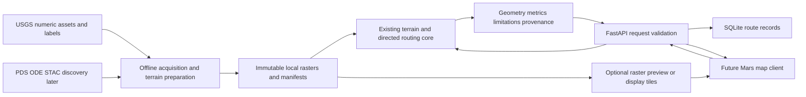

# Backend architecture and proposed API

Status: design only, 2026-11-14. The repository has a Python CLI/core, not an HTTP backend. Reuse it; no source changes or dependencies were introduced by this task.

## Stack decision

| Option | Assessment |
|---|---|
| Python + existing NumPy/Rasterio/PyProj + FastAPI | Recommended. Keeps tested routing and raster tooling together; typed validation/OpenAPI fit the small REST boundary. FastAPI is a proposed new dependency, not installed by this task |
| Node/TypeScript service | Useful if an application stack later requires it, but currently adds a second runtime or rewrites the working numerical core |
| C++/Rust routing service | Consider only if profiling demonstrates CPU/memory limits; no current requirement justifies migration |
| PostgreSQL/PostGIS | Useful later for many regions, concurrent edits and spatial footprints. Unnecessary for one prepared crop; Earth-default geography calculations must never be used for Mars |

MVP: one host, one application deployment, existing Python environment versions, FastAPI/ASGI server when implemented, local immutable raster files plus small JSON region manifests. SQLite (standard library) stores route metadata/results references; no ORM required initially. Prepare data offline using the existing core. No live archive dependency in the route request. No Redis, Celery, Kubernetes, machine-learning runtime or separate GIS server is needed.



## Data pipeline and coordinate contract

1. Register the known S1 asset from [DATA_AVAILABILITY](../research/DATA_AVAILABILITY.md). Later discovery follows documented PDS/ODE/STAC links, then verifies target body, product type and labels. Catalog hits alone do not become routable regions.
2. Inspect label/header, units, scale/offset, NoData, geometry, vertical reference and terms. Verify byte-range responses and impose transfer/time/size limits. The existing remote strip reader is not a tiny-transfer guarantee; instrument actual bytes before expanding regions.
3. Window the native source plus required derivative support. Preserve source values and crop transform; stage outputs and publish a completed manifest only after hash and read-back validation. Current TIFF and sidecar are not an atomic pair; incomplete caches fail safely, but concurrent writers need a per-region lock and completed-manifest publication.
4. Derive slope, edge grades and known mask. Optional roughness uses a declared physical neighborhood and detrended residual, with enough halo. Align real hazard masks by frame/transform, not merely equal array shape. Keep derivative support distinct from hazard buffers.
5. Persist versioned derived assets and lineage. Separate unthresholded derivatives from policy-dependent permitted masks. Do not interpolate unknown cells into known-safe terrain. Conservative hazard aggregation must preserve any blocked contribution when changing resolution.
6. Register only prepared valid coverage. Load bounded arrays, generate neighbors implicitly, run the requested objective, verify budget semantics and serialize finite metrics with complete provenance.

Canonical external convention: body Mars, east-positive longitude in [-180,180), planetocentric latitude [-90,90]. Explicitly reject ambiguous lat/lon order or unsupported latitude/frame conventions. Selected product uses spherical radius 3,396,190 m and equatorial equirectangular projection. Preserve full WKT and original labels. Planetographic latitude on an ellipsoid is not interchangeable with planetocentric latitude; changing that convention is a real transformation. Do not relabel planetary coordinates as EPSG:4326/3857, calculate Earth geodesics, or store routes as PostGIS Earth geography.

Distance uses the local metric in [ROUTING_ALGORITHM](ROUTING_ALGORITHM.md), including latitude scale correction. Source height follows its MOLA/DeltaGeoid history; no Earth vertical datum substitution. Future mixed-source ingestion must reconcile vertical datum, shape model, control and longitude wrap before interpolation. The CTX catalog radius discrepancy is an explicit ingestion blocker.

The selected crop's bounds are approximately `[77.44783511,18.44284401,77.45215399,18.44716288]`; extent is not a promise every pixel is valid. Public geometry is a custom Mars JSON schema with LineString-style arrays, **not RFC 7946 GeoJSON**. The frontend must use a Mars-aware projection/distance model and visible source coverage. Provide requested and snapped coordinates, cell indices and displacement; geometry is the actual computed cell route, not a schematic straight line. Do not imply a short crop covers Jezero as a whole.

## Storage, caching and execution

Region manifest: ID/version, bounds and valid footprint, source product/URL/label, source checksum or object identity, crop SHA-256, WKT, transform, resolution, units, vertical reference, NoData/quality support, processing version, source observation/publication/retrieval times when available, and attribution/terms. A multipart S3 ETag is an object identity, not the crop SHA-256. Missing observation time stays null.

Route record: canonical request, scenario/policy version, layer hashes, algorithm version, cells/geometry, metrics, limitations, computation status and creation time. Key cached results by all those semantic inputs, endpoints and objective. Reverse-time caches also include base and time model; policy masks include slope/buffer settings. Never reuse a route after its hazard/model version changes. Cache the numeric result, not just a rendered image. Endpoint-containing cells can share core results, but requested coordinates/snap metadata must remain request-specific.

Memory is bounded by region size and concurrent jobs. Start with one routing computation at a time; a process worker can isolate CPU work from the HTTP event loop. Benchmark real start/goal pairs, cold/warm caches, reverse search, worst reachable/unreachable cases, wall time, peak memory and expanded nodes. A suggested service target is warm p95 under two seconds for the registered crop; this is an engineering target, not a measured result. Existing tests' subsecond runtime is not an API throughput benchmark.

MVP prepares terrain offline and returns synchronous routes only within measured limits. For later slow preparation/routing, use a single-host durable SQLite job table and one worker process; transactionally claim jobs, persist progress/result or failure, bound retries and recover stale jobs on restart. Return 202 and a status URL; do not rely on an in-memory web background task for durable work. Object storage and PostgreSQL become justified with multiple hosts or many regions. Keep raster payloads in files/object storage; PostGIS can index footprints in explicitly defined Mars geometry if needed.

## Proposed REST contract

All endpoints below are **proposed**, not existing public or local services. JSON errors use stable codes, message, relevant fields, and capability/coverage details. Unknown request fields should be rejected. Numeric inputs must be finite and bounded; validate reserve<=budget, scenario compatibility, region versions and payload size. Never accept arbitrary remote dataset URLs or filesystem paths from route requests.

| Endpoint | Contract |
|---|---|
| `GET /api/v1/regions` | Prepared region IDs, footprints, versions, supported objectives/layers, coordinate convention and limitations |
| `GET /api/v1/regions/{id}/terrain` | Manifest, CRS, resolution, source lineage, known-data coverage, policy availability and named assets |
| `GET /api/v1/regions/{id}/hazards?bbox=west,south,east,north` | Only known masks/features with type, source, confidence semantics and coverage. Return `status:unavailable` for absent hazard families, not an empty “safe” result |
| `POST /api/v1/routes` | Start/goal, prepared region version, objective, explicit scenario/policy and time constraints |
| `GET /api/v1/routes/{id}` | Persisted result and complete provenance; 404 for unknown ID |
| `GET /api/v1/routes/{id}/metrics` | Same authoritative metrics subset, not a second computation |
| `GET /api/v1/routes/{id}/profile` | Along-route distance, elevation, cell/edge slope, known-mask flags, scenario elapsed time; maximum sample count and stated sampling method |
| `GET /api/v1/jobs/{id}` | Future asynchronous state: queued/running/succeeded/failed, result URL or structured error |

Initial request example, compatible with the saved two-point scenario:

```json
{
  "region_id": "jezero-demo-256",
  "region_version": "1",
  "coordinates": {"body": "Mars", "longitude": "east_-180_180", "latitude": "planetocentric", "units": "degrees"},
  "start": [77.4485183698317, 18.44647962260933],
  "destination": [77.4513863726576, 18.443611619783454],
  "objective": "scenario_time",
  "scenario": {"id": "demo-v1", "speed_m_s": 0.5, "uphill_factor": 4, "downhill_factor": 2},
  "constraints": {"max_slope_deg": 15, "budget_s": 3600, "reserve_s": 600, "return_base": "start"},
  "required_layers": ["elevation", "slope"],
  "unknown_hazard_policy": "disclose_research_limitations"
}
```

`shortest_distance` is the other planned objective. Reject `safest`, `metabolic_energy`, unimplemented physical constraints and unsupported preferences with 422; do not silently downgrade. The example numbers are explicitly a demonstration policy. Server policy should bound allowed parameter ranges for compute and numerical validity without presenting those bounds as physiological thresholds. Region metadata lists only actually implemented capabilities.

Response envelope below illustrates the proposed API using the complete geometry and rounded metrics from [the saved route](../../examples/two_point/route.json). This adapts a recorded CLI result; it is not an execution of a new HTTP service. Unknown operational metrics remain null.

```json
{
  "id": "illustrative-route-id",
  "schema": "mars-route-api-v1",
  "status": "computed",
  "region_id": "jezero-demo-256",
  "objective": "scenario_time",
  "coordinate_reference": {
    "body": "Mars", "longitude": "east_-180_180", "latitude": "planetocentric",
    "radius_m": 3396190, "vertical_reference": "source MOLA topography / DeltaGeoid processing"
  },
  "geometry": {"type":"LineString","coordinates":[[77.4485183698317,18.44647962260933,-2569.126220703125],[77.44853524043657,18.446462752004475,-2569.031005859375],[77.44855211104142,18.446445881399615,-2568.93408203125],[77.44856898164629,18.44642901079476,-2568.844970703125],[77.44858585225113,18.4464121401899,-2568.7724609375],[77.448602722856,18.44639526958504,-2568.72265625],[77.44861959346086,18.446378398980183,-2568.694091796875],[77.44863646406571,18.446361528375324,-2568.66796875],[77.44865333467057,18.446344657770467,-2568.671142578125],[77.44867020527543,18.446327787165608,-2568.722900390625],[77.44868707588029,18.44631091656075,-2568.68359375],[77.44870394648515,18.44629404595589,-2568.535888671875],[77.44872081709,18.44627717535103,-2568.39453125],[77.44873768769486,18.446260304746176,-2568.27880859375],[77.44875455829973,18.446243434141316,-2568.177490234375],[77.44877142890458,18.44622656353646,-2568.0947265625],[77.44878829950943,18.4462096929316,-2568.01904296875],[77.4488051701143,18.446192822326744,-2567.934326171875],[77.44882204071915,18.446175951721884,-2567.82568359375],[77.44883891132402,18.446159081117028,-2567.666259765625],[77.44885578192887,18.446142210512168,-2567.457763671875],[77.44887265253372,18.446125339907308,-2567.18994140625],[77.44888952313859,18.44610846930245,-2566.871337890625],[77.44890639374346,18.446091598697592,-2566.5400390625],[77.4489232643483,18.446074728092736,-2566.23876953125],[77.44894013495316,18.446057857487876,-2566.007080078125],[77.44895700555801,18.44604098688302,-2565.86328125],[77.44897387616287,18.44602411627816,-2565.76953125],[77.44899074676773,18.446007245673304,-2565.723876953125],[77.44900761737259,18.445990375068444,-2565.71875],[77.44902448797745,18.445973504463584,-2565.729736328125],[77.4490413585823,18.44595663385873,-2565.739013671875],[77.44905822918716,18.44593976325387,-2565.7509765625],[77.44907509979203,18.445922892649016,-2565.783935546875],[77.44909197039689,18.445906022044156,-2565.85986328125],[77.44910884100173,18.4458891514393,-2565.96337890625],[77.4491257116066,18.44587228083444,-2566.059326171875],[77.44914258221146,18.44585541022958,-2566.130859375],[77.44915945281632,18.445838539624724,-2566.18896484375],[77.44917632342117,18.445821669019864,-2566.253173828125],[77.44919319402602,18.445804798415008,-2566.3291015625],[77.44921006463089,18.445787927810148,-2566.399169921875],[77.44922693523576,18.44577105720529,-2566.441162109375],[77.4492438058406,18.445754186600432,-2566.4658203125],[77.44926067644546,18.445737315995572,-2566.518798828125],[77.44927754705033,18.445720445390716,-2566.61474609375],[77.44929441765518,18.445703574785856,-2566.73681640625],[77.44931128826003,18.445686704181,-2566.890380859375],[77.4493281588649,18.44566983357614,-2567.029296875],[77.44934502946975,18.445652962971284,-2567.1171875],[77.44936190007462,18.445636092366424,-2567.163330078125],[77.44937877067947,18.445619221761568,-2567.1982421875],[77.44939564128433,18.445602351156708,-2567.212158203125],[77.4494125118892,18.44558548055185,-2567.189697265625],[77.44942938249405,18.445568609946992,-2567.14111328125],[77.4494462530989,18.445551739342132,-2567.093505859375],[77.44946312370377,18.445534868737276,-2567.048828125],[77.44947999430862,18.445517998132416,-2567.0009765625],[77.44949686491348,18.44550112752756,-2566.978271484375],[77.44951373551834,18.4454842569227,-2567.00146484375],[77.44953060612319,18.445467386317844,-2567.08154296875],[77.44954747672806,18.445450515712984,-2567.186767578125],[77.44956434733291,18.445433645108125,-2567.2890625],[77.44958121793776,18.44541677450327,-2567.367919921875],[77.44959808854263,18.44539990389841,-2567.415283203125],[77.44961495914748,18.445383033293556,-2567.45263671875],[77.44963182975233,18.445366162688696,-2567.495361328125],[77.4496487003572,18.44534929208384,-2567.56005859375],[77.44966557096205,18.44533242147898,-2567.63818359375],[77.44968244156692,18.44531555087412,-2567.718017578125],[77.44969931217177,18.445298680269264,-2567.78369140625],[77.44971618277663,18.445281809664404,-2567.81787109375],[77.4497330533815,18.44526493905955,-2567.829345703125],[77.44974992398636,18.44524806845469,-2567.8466796875],[77.4497667945912,18.445231197849832,-2567.869873046875],[77.44978366519607,18.445214327244972,-2567.895751953125],[77.44980053580093,18.445197456640113,-2567.93896484375],[77.44981740640578,18.445180586035256,-2568.022216796875],[77.44983427701064,18.445163715430397,-2568.142822265625],[77.44985114761549,18.44514684482554,-2568.267578125],[77.44986801822036,18.44512997422068,-2568.361572265625],[77.44988488882522,18.445113103615824,-2568.4228515625],[77.44990175943006,18.445096233010965,-2568.4833984375],[77.44991863003493,18.44507936240611,-2568.573974609375],[77.4499355006398,18.44506249180125,-2568.68994140625],[77.44995237124465,18.44504562119639,-2568.799560546875],[77.4499692418495,18.445028750591533,-2568.881591796875],[77.44998611245437,18.445011879986673,-2568.93359375],[77.45000298305922,18.444995009381817,-2568.967041015625],[77.45001985366409,18.444978138776957,-2568.991943359375],[77.45003672426894,18.4449612681721,-2569.02783203125],[77.4500535948738,18.44494439756724,-2569.080810546875],[77.45007046547866,18.444927526962385,-2569.142578125],[77.4500873360835,18.444910656357525,-2569.208984375],[77.45010420668837,18.444893785752665,-2569.277099609375],[77.45012107729323,18.44487691514781,-2569.3447265625],[77.45013794789809,18.44486004454295,-2569.4013671875],[77.45015481850294,18.444843173938093,-2569.445068359375],[77.4501716891078,18.444826303333233,-2569.47265625],[77.45018855971266,18.44480943272838,-2569.481689453125],[77.45020543031752,18.44479256212352,-2569.482177734375],[77.45022230092238,18.44477569151866,-2569.4853515625],[77.45023917152723,18.444758820913805,-2569.500732421875],[77.4502560421321,18.444741950308945,-2569.516845703125],[77.45027291273695,18.44472507970409,-2569.51806640625],[77.4502897833418,18.44470820909923,-2569.502197265625],[77.45030665394667,18.444691338494373,-2569.48828125],[77.45032352455152,18.444674467889513,-2569.48828125],[77.45034039515639,18.444657597284653,-2569.497314453125],[77.45035726576124,18.444640726679797,-2569.50927734375],[77.4503741363661,18.444623856074937,-2569.525634765625],[77.45039100697096,18.44460698547008,-2569.547119140625],[77.45040787757583,18.44459011486522,-2569.5634765625],[77.45042474818067,18.444573244260365,-2569.563720703125],[77.45044161878553,18.444556373655505,-2569.552490234375],[77.4504584893904,18.44453950305065,-2569.544921875],[77.45047535999525,18.44452263244579,-2569.533935546875],[77.4504922306001,18.44450576184093,-2569.5068359375],[77.45050910120496,18.444488891236073,-2569.46728515625],[77.45052597180982,18.444472020631213,-2569.437744140625],[77.45054284241469,18.444455150026357,-2569.42919921875],[77.45055971301953,18.444438279421497,-2569.44873046875],[77.4505765836244,18.44442140881664,-2569.496826171875],[77.45059345422926,18.44440453821178,-2569.53515625],[77.45061032483412,18.444387667606925,-2569.533935546875],[77.45062719543897,18.444370797002065,-2569.518310546875],[77.45064406604384,18.444353926397206,-2569.5107421875],[77.45066093664869,18.44433705579235,-2569.518798828125],[77.45067780725354,18.44432018518749,-2569.531005859375],[77.45069467785841,18.444303314582633,-2569.54296875],[77.45071154846326,18.444286443977774,-2569.555908203125],[77.45072841906813,18.444269573372917,-2569.5634765625],[77.45074528967297,18.444252702768058,-2569.5634765625],[77.45076216027783,18.4442358321632,-2569.560791015625],[77.4507790308827,18.444218961558345,-2569.54443359375],[77.45079590148755,18.444202090953485,-2569.5185546875],[77.4508127720924,18.44418522034863,-2569.522705078125],[77.45082964269727,18.44416834974377,-2569.5537109375],[77.45084651330212,18.444151479138913,-2569.572021484375],[77.45086338390699,18.444134608534053,-2569.562255859375],[77.45088025451184,18.444117737929194,-2569.52685546875],[77.4508971251167,18.444100867324337,-2569.510009765625],[77.45091399572156,18.444083996719478,-2569.508544921875],[77.45093086632642,18.44406712611462,-2569.50927734375],[77.45094773693127,18.44405025550976,-2569.489501953125],[77.45096460753614,18.444033384904905,-2569.439453125],[77.45098147814099,18.444016514300046,-2569.37841796875],[77.45099834874586,18.44399964369519,-2569.306396484375],[77.45101521935071,18.44398277309033,-2569.22412109375],[77.45103208995556,18.44396590248547,-2569.150390625],[77.45104896056043,18.443949031880614,-2569.096435546875],[77.4510658311653,18.443932161275754,-2569.0595703125],[77.45108270177013,18.443915290670898,-2569.031005859375],[77.451099572375,18.443898420066038,-2569.016357421875],[77.45111644297985,18.44388154946118,-2569.02294921875],[77.45113331358472,18.443864678856322,-2569.032470703125],[77.45115018418957,18.443847808251466,-2569.057373046875],[77.45116705479442,18.443830937646606,-2569.080078125],[77.45118392539929,18.443814067041746,-2569.119873046875],[77.45120079600416,18.44379719643689,-2569.15380859375],[77.451217666609,18.44378032583203,-2569.17431640625],[77.45123453721386,18.443763455227174,-2569.194091796875],[77.45125140781873,18.443746584622314,-2569.21533203125],[77.45126827842357,18.443729714017458,-2569.236328125],[77.45128514902844,18.443712843412598,-2569.253173828125],[77.4513020196333,18.443695972807742,-2569.1865234375],[77.45131889023816,18.443679102202886,-2569.133544921875],[77.45133576084301,18.443662231598026,-2569.111083984375],[77.45135263144786,18.44364536099317,-2569.08935546875],[77.45136950205273,18.44362849038831,-2569.069580078125],[77.4513863726576,18.443611619783454,-2569.042724609375]]},
  "endpoint_mapping": {"requested":[[77.4485183698317,18.44647962260933],[77.4513863726576,18.443611619783454]],"snapped_cells":[[40,40],[210,210]],"snapped_coordinates":[[77.4485183698317,18.44647962260933,-2569.126220703125],[77.4513863726576,18.443611619783454,-2569.042724609375]],"distance_includes_requested_to_center_access":false},
  "metrics": {
    "distance_3d_m": 234.7044, "scenario_walking_s": 525.8076,
    "estimated_operational_walking_s": null, "ascent_m": 4.6968, "descent_m": 4.6133,
    "max_edge_slope_deg": 13.5151, "minimum_nominal_return_margin_s": 1948.8549,
    "risk_probability": null, "metabolic_energy_j": null
  },
  "assessment": {"scope": "represented_terrain_scenario", "operational_safety": "not_assessed", "difficulty": {"method": "report_slope_and_ascent_only", "categorical_rating": null}},
  "model": {"id": "demo-v1", "calibration": "uncalibrated", "speed_m_s": 0.5, "uphill_factor": 4, "downhill_factor": 2, "max_slope_deg": 15},
  "provenance": {
    "product": "JEZ_hirise_soc_006_DTM_MOLAtopography_DeltaGeoid_1m_Eqc_latTs0_lon0_blend40",
    "crop_sha256": "e45041be98107edaa2c6bec80fd658bbb3609d31cab69246b0434158033da2a9",
    "terrain_manifest_url": "/api/v1/regions/jezero-demo-256/terrain"
  },
  "limitations": ["Unresolved foot-scale obstacles and soil properties", "No physiological, weather or communication feasibility", "Nominal return only"]
}
```

Actual geometry must include every route vertex `[east_lon_deg, planetocentric_lat_deg, source_elevation_m]` and actual endpoint mappings. To inspect a full numeric example now, use the saved route JSON; do not replace it with a two-endpoint straight line. For a one-cell route, specify a Point geometry or reject identical containing cells consistently; do not emit an invalid one-vertex LineString. Large future results may use an authenticated result asset URL, not silently truncated geometry.

Suggested region response fragment:

```json
{"regions":[{"id":"jezero-demo-256","version":"1","bbox":[77.44783511,18.44284401,77.45215399,18.44716288],"projected_posting_m":1,"status":"prepared","supported_layers":["elevation","slope"],"unknown_layers":["foot_obstacles","soil_strength","weather"],"objectives":["scenario_time"]}]}
```

Future asynchronous acceptance: `202`, `Location: /api/v1/jobs/{id}`, body `{"job_id":"id","status":"queued","status_url":"/api/v1/jobs/id"}`. Successful polling points to the same route schema. Specify retention and cancellation when that feature is added.

## Errors and unavailable data

| Condition | HTTP / stable code | Meaning |
|---|---|---|
| Invalid numbers/frame/objective | 422 `INVALID_REQUEST` / `UNSUPPORTED_CAPABILITY` | Includes offending fields; no Earth fallback |
| Outside prepared region or unknown endpoint | 422 `OUTSIDE_COVERAGE` / `UNSUPPORTED_ENDPOINT` | No silent coarse DEM fallback or nearest-safe snapping |
| Required hazard missing | 422 `REQUIRED_LAYER_UNAVAILABLE` | Report missing coverage and source readiness |
| Exhaustive static graph search disconnected | 422 `NO_PATH_IN_PREPARED_REGION` | Only this region, resolution and policy; no global infeasibility claim |
| Post-search budget failure | 422 `CANDIDATE_BUDGET_REJECTED` | `feasibility_complete=false`; another constrained route may exist |
| Corrupt cache / source outage during preparation | 503 `TERRAIN_UNAVAILABLE` | Distinguish internal integrity error from archive access; no synthetic fallback |
| Queue/compute capacity | 429 `CAPACITY_EXCEEDED` or future 202 | Retry-After; deterministic bounded work |
| Search deadline | 503 `COMPUTATION_LIMIT` | Not proof that no path exists |

## Validation and deployment

Keep current offline tests and immutable real crop. Add API contract tests for finite JSON, coordinate order/body, unsupported capabilities, snap disclosure, hash mismatch, missing layers, no path, and candidate budget rejection. Verify every returned edge/metric against the core; compare shortest/time objectives with Dijkstra on small analytical fixtures. Read-only remote smoke tests are optional scheduled checks, not required for every offline test run.

Deploy one service with pinned dependencies, read-only prepared terrain volume, writable SQLite/results directory, health/readiness checks and bounded workers. Validate GDAL/PROJ data packaging on the deployment OS. Back up manifests and SQLite consistently; hashes detect corruption. Log region/model versions, timing and error codes; never log credentials. Use TLS and request limits; if public, add rate limiting and restrict CORS to the eventual client. No authentication service is needed for local development; decide user ownership/access controls before storing private mission plans in a shared deployment. Avoid exposing arbitrary remote fetches (SSRF), unbounded crops, or filesystem paths.
